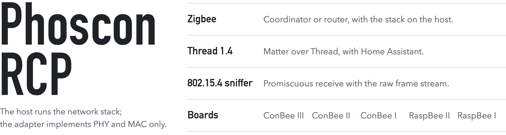

<picture><source media="(prefers-color-scheme: dark) and (max-width: 600px)" srcset="docs/images/opener-phone-dark.png"><source media="(max-width: 600px)" srcset="docs/images/opener-phone-light.png"><source media="(prefers-color-scheme: dark)" srcset="docs/images/opener-dark.png"></picture>

Firmware that turns dresden elektronik's ConBee and RaspBee adapters into a plain IEEE 802.15.4 radio. A host drives it over [Spinel](https://openthread.io/platforms/co-processor), the protocol OpenThread uses for its radio co-processors, and runs the whole network stack itself. The firmware keeps no state across a reset and writes no network data to flash.

## Hosts

Hosts that have run on this firmware are OpenThread, including the Home Assistant border router app, Ziggurat, and zigbee-on-host through Zigbee2MQTT. Phoscon Zigbee Stack, the reference Zigbee host, is to be released separately.

This is an early release.

## Boards

**ConBee III** runs Zigbee and Thread hosts. An EFR32MG21 on Silicon Labs' RAIL radio library, behind a USB serial bridge at 115 200 baud.

**ConBee II** runs Zigbee and Thread hosts. An ATSAMR21E18A with an AT86RF233 radio, on native USB.

**RaspBee II** runs Zigbee and Thread hosts. An ATSAMR21E18A with an AT86RF233 radio, on the Raspberry Pi header UART at 115 200 baud.

**ConBee I** is a proof of concept and runs Zigbee and Thread hosts. An ATmega256RFR2 behind a USB serial bridge at 57 600 baud.

**RaspBee I** is a proof of concept and shares the ConBee I's image. An ATmega256RFR2 on the Raspberry Pi header UART at 57 600 baud.

## Flash it

**In the browser:** <https://phoscon.de/updater> flashes a ConBee over USB, in Chrome or Edge, with nothing to install.

**In the terminal:** With [GCFFlasher](https://github.com/dresden-elektronik/gcfflasher/releases) 4.12.6 or newer. Download your board's firmware from the [releases](https://github.com/dresden-elektronik/phoscon-rcp/releases) and pass the stick's port explicitly.

```sh
GCFFlasher -t 30 -d <port> -f phoscon-rcp-<version>-<board>.GCF
```

| board      | `<board>` | note                                                                                                         |
| ---------- | --------- | ------------------------------------------------------------------------------------------------------------ |
| ConBee III | `cb3`     |                                                                                                             |
| ConBee II  | `cb2`     |                                                                                                             |
| ConBee I   | `cbrb1`   |                                                                                                             |
| RaspBee II | `rb2`     | run on the Raspberry Pi, see [flashing a RaspBee](docs/build-and-flash.md#51-the-raspbees-on-a-raspberry-pi) |
| RaspBee I  | `cbrb1`   | run on the Raspberry Pi, see [flashing a RaspBee](docs/build-and-flash.md#51-the-raspbees-on-a-raspberry-pi) |

## Writing or debugging a host

The source is here to read when you need to know what the radio is doing.

| question                                   | look in                                                                                                                    |
| ------------------------------------------ | -------------------------------------------------------------------------------------------------------------------------- |
| does it support feature X, on which board? | [protocol: features per board](docs/protocol.md#features-per-board)                                                        |
| what goes over the wire?                   | [`docs/protocol.md`](docs/protocol.md)                                                                                     |
| how does it set Frame Pending?             | [`docs/ack-pending-frame.md`](docs/ack-pending-frame.md)                                                                   |
| how is the firmware built up?              | [`docs/architecture.md`](docs/architecture.md), [`docs/boards.md`](docs/boards.md), [`docs/hardware.md`](docs/hardware.md) |

A stick reports its release in `NCP_VERSION`: `DSPINEL/1.0; <radio>; phoscon-rcp <version>`.

## Report a problem or request a feature

Open a [GitHub issue](https://github.com/dresden-elektronik/phoscon-rcp/issues) for the firmware. A problem in a host or application belongs to that project. Pull requests are not merged: the maintainers make every change ([`CONTRIBUTING.md`](CONTRIBUTING.md)). Report a security problem privately ([`SECURITY.md`](SECURITY.md)). What changed in each release is [`CHANGELOG.md`](CHANGELOG.md).

## Build it

[`docs/build-and-flash.md`](docs/build-and-flash.md) has the toolchains and commands. The images and host suites need only those toolchains. Packaging an image for a stick also needs `GCFTool` and the board keys, which dresden elektronik hands out on request. [`docs/coding-rules.md`](docs/coding-rules.md) and [`docs/testing.md`](docs/testing.md) cover how the code is changed, and [`AGENTS.md`](AGENTS.md) is the working contract for coding agents.

## License

BSD 3-Clause, see [`LICENSE`](LICENSE). The ConBee III's image links Silicon Labs' RAIL library, under its own licence: the library is fetched at build time and is not in this repository, and a released ConBee III container includes it ([`src/lib/PROVENANCE.md`](src/lib/PROVENANCE.md)).
